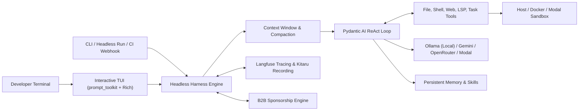

<div align="center">
  <h1>xape</h1>
  <p><strong>The autonomous terminal coding agent with fluid local and cloud intelligence.</strong></p>
  <p>Run 100% private, zero-cost coding agents on your local hardware via Ollama, or tap frontier cloud models with Bring-Your-Own-Key (Gemini, OpenRouter, Modal).</p>

  <p align="center">
    <a href="#-quick-start"></a>
    <a href="#-local--cloud-providers"></a>
    <a href="LICENSE"></a>
    
    <a href="#-b2b-sponsorship--monetization"></a>
  </p>
</div>

---

## ⚡ Why xape?

Most AI coding assistants force developers into a false dilemma: pay a \$20–\$200/month recurring subscription while streaming proprietary code to commercial cloud servers, or settle for crippled offline tools.

**`xape`** delivers a developer-first agentic harness that unifies **local-first privacy** with **cloud power**:

* **$0 Inference & 100% Offline:** Drive autonomous coding tasks entirely on your laptop GPU or Apple Silicon using **Ollama** (`qwen2.5-coder:7b`, `qwen3:8b`, `deepseek-coder`, `llama3`).
* **Bring Your Own Key (BYOK):** Switch to frontier cloud intelligence (**Google Gemini** e.g. `gemini-2.5-flash`, **OpenRouter**, or custom **Modal** GPU endpoints) whenever you need large context windows or massive reasoning capacity.
* **Live Mid-Turn Steering:** Steer running tasks on the fly with `Enter`, queue follow-ups with `Alt+Enter`, or cooperatively abort with `Esc`.
* **Isolated Sandboxing:** Run unsafe bash commands and file mutations safely in isolated Docker or Modal cloud containers, with automatic Git hand-back (`xape/<session-id>`).
* **Sustainable Open Source:** Funded by developer-respectful, terminal-native B2B sponsorships with an ironclad **Zero Code Leakage Guarantee**—no paywalls, no tracking, completely opt-outable.

---

## 🚀 Quick Start

### 1. Install

Requires [uv](https://docs.astral.sh/uv/) and Python 3.12+.

```bash
# Clone the repository
git clone https://github.com/HanishDhanwalkar/xape-ollama.git
cd xape-ollama

# Install dependencies and setup git hooks
make install

# Expose `xape` on your PATH (tracking this checkout)
make install-cli
```

*(On Windows, run `./build.ps1 install` and `./build.ps1 install-cli`)*

### 2. Configure Your Provider

Copy the template configuration:

```bash
cp .env.example .env
```

Pick your preferred model backend in `.env`:

```ini
# Option A: 100% Local & Free (Ollama)
LLM_PROVIDER=ollama
OLLAMA_BASE_URL=http://localhost:11434
OLLAMA_MODEL=qwen3:8b

# Option B: High-Speed Cloud (Gemini) - Free key at https://aistudio.google.com/apikey
LLM_PROVIDER=gemini
GEMINI_API_KEY=your-gemini-key

# Option C: Universal Router (OpenRouter)
LLM_PROVIDER=openrouter
OPENROUTER_API_KEY=your-openrouter-key
```

### 3. Launch

```bash
xape
```

Type a prompt, e.g.:
```text
❯ Inspect the current repo and write a unit test for xape.sponsors.rotator
```

---

## 🌟 Key Features

### 🔄 Fluid Compute: Switch Models on the Fly (`/model`)
Don't restart your agent when a problem outgrows your local model. Type `/model` in the interactive TUI to open a live picker. Seamlessly transition the active conversation from a local Ollama model to Gemini (e.g. `gemini-2.5-flash`), OpenRouter, or Modal without losing turn history or memory.

### 🎮 Interactive TUI & Live Turn Steering
Built with `prompt_toolkit` and `Rich`, `xape` gives you tactile control over the agent loop:
* **Steer (`Enter` while working):** Injects new directions before the next tool call without aborting the run.
* **Follow-up (`Alt+Enter`):** Queues a follow-up action to execute as soon as the current task completes.
* **Abort (`Esc`):** Gracefully interrupts the loop while preserving full conversation state.
* **Permission Modes (`Shift+Tab` or `/mode`):** Cycle between `default` (ask on mutation), `plan` (read-only), `edit` (auto-allow edits, gate bash), and `bypass`.

### 🛡️ Sandboxing & Deterministic Git Hand-Back
Execute code with confidence:
* **Host Mode (`none`):** Fast local execution against your current working directory.
* **Local Docker (`docker`):** Runs bash and tools inside an isolated container over a bind-mounted workspace.
* **Remote Cloud (`modal`):** Runs untrusted workflows in ephemeral cloud sandboxes.
* **Git Hand-Back:** On exit or when you type `/ship`, all uncommitted changes are bundled into a dedicated `xape/<session-id>` git branch and pushed to origin using ambient host credentials—no tokens ever leak into the sandbox.

### 🧠 Two-Tier Compaction & Persistent Memory
* **Microcompaction:** Automatically prunes bulky tool outputs at ~60% context capacity without LLM overhead.
* **Full Compaction:** Generates structured semantic summaries at ~80% context window to keep agent conversations flowing indefinitely.
* **Persistent Memory:** Preserves architectural conventions across sessions in `.xape/MEMORY.md` and `AGENTS.md`.

### 🔍 Code Intelligence (LSP)
Built-in Language Server Protocol client (`ty` by default) automatically runs post-edit compiler diagnostics to catch syntax and type errors before reporting back to you.

---

## 🤖 Specialized Agent Personas

Switch agent specializations anytime with `/agent <name>`:

| Persona | Purpose | Key Tools |
| :--- | :--- | :--- |
| **`build`** (Default) | Full development cycle: reading, editing, testing, shell execution. | `read`, `edit`, `write`, `bash`, `web_fetch`, `todo`, `lsp` |
| **`plan`** | High-level system architecture and safe research without mutating disk. | Read-only tools + Plan approval gate |
| **`code-reviewer`**| Adversarial review: audits diffs, syntax, logic bugs, and test coverage. | Diff inspection, git tools, diagnostics |
| **`explore`** | Scoped child subagent spawned via the `agent` tool for parallel research. | Read-only fan-out, structured report consolidation |

---

## 📢 B2B Sponsorship & Monetization (ADR-0026)

`xape` is free and open-source software funded sustainably by non-intrusive, developer-targeted B2B sponsorships.

```
+-----------------------------------------------------------------------------------+
|  [Main Terminal Stream]                                                           |
|  Decode: Analyzing repository structure...                                        |
|  📢 Sponsored by Modal | Serverless GPU compute for AI/ML | visit                 | <── (1) Clickable OSC 8 Link
|  Decode: Found 12 matching files.                                                 |
|                                                                                   |
|  [Persistent Prompt & Toolbar]                                                    |
|  ❯ refactor database connection pool                                              |
|  📢 Sponsored by Modal | Serverless GPU compute for AI/ML | https://modal.com     | <── (2) Persistent TUI Footer
|  ⠋ working…  ◕ 42% agent:build mode:default | Enter steer | Alt+Enter follow-up   | <── (3) Decoupled Status Spinner
+-----------------------------------------------------------------------------------+
```

### Placements
1. **Persistent TUI Footer Banner:** A dedicated single line positioned cleanly above the status bar.
2. **Response / Stream Ads:** Emitted into the output buffer on startup and turn rotation via Rich, featuring **clickable OSC 8 hyperlinks** (`visit`) for modern terminals (`Cmd/Ctrl + Click`).
3. **Decoupled Reasoning Spinner:** The busy spinner animation (`working…`) is kept completely clean to eliminate visual jitter and screen flicker during reasoning loops.

### Zero Code Leakage Guarantee
* Telemetry sent to the campaign server is strictly limited to `{ client_version, os_type, python_version }`.
* **Hardcoded Blacklist:** `FORBIDDEN_METADATA_KEYS` strictly rejects and blocks prompts, code snippets, git diffs, file paths, repository URLs, environment variables, or API tokens.

### Opting Out
Users in air-gapped environments or enterprise teams can disable sponsors anytime:
* **CLI Flag:** `xape --no-ads`
* **Local Settings:** Set `"ads": false` in `.xape/settings.json`
* **Environment:** Set `SPONSORS_ENABLED=false` in `.env`

---

## ⌨️ Command Reference

### Interactive Slash Commands

| Command | Action |
| :--- | :--- |
| `/model` | Open the interactive provider and model picker |
| `/agent <name>` | Switch active agent (`build`, `plan`, `code-reviewer`) |
| `/mode <name>` | Set permission mode (`default`, `plan`, `edit`, `bypass`) |
| `/compact` | Trigger immediate context compaction |
| `/clear` | Summarize session to memory and reset conversation |
| `/ship` | Push sandbox workspace back as a `xape/<session-id>` git branch |
| `/<skill>` | Execute a project skill from `.xape/skills/` |
| `/quit` | Exit session cleanly |

### Session Management

```bash
# Resume the most recent session
xape --resume

# Resume a specific session by ID
xape --resume <session-id>

# List all past sessions
xape sessions

# Run headless (ideal for CI/CD and scripts)
xape run "Fix broken pytest fixtures in tests/unit/"
```

---

## ⚙️ Architecture



---

## 📚 Documentation & Guides

Comprehensive product guides are available in [`docs/`](docs/):

* [Getting Started](docs/getting-started.md): Installation, quick start, interactive keys, and session resumption.
* [Model Providers](docs/providers.md): Setting up Ollama, Gemini, OpenRouter, and Modal endpoints.
* [Sandboxing & Isolation](docs/sandboxing.md): Local Docker and remote Modal sandboxing setups, git hand-back, and PAT security.
* [Headless & Remote Deployments](docs/headless-and-remote.md): Running `xape run` in scripts and deploying headless agents on Modal.
* [Evaluations & Observability](docs/evals-and-observability.md): Distributed tracing with Langfuse and benchmark evaluation suites.
* [Session Recording & Replays](docs/session-recording-and-replays.md): Recording and deterministic what-if replays with Kitaru.
* [Troubleshooting](docs/troubleshooting.md): Diagnosing preflight checks, provider connections, and tool failures.
* [Architecture Decision Records (ADRs)](docs/adr/): Technical decisions and architectural design history.
* [Glossary](docs/glossary.md): Canonical domain vocabulary and definitions.

---

## 📄 License & Attribution

Released under the [Apache-2.0 License](LICENSE).
See [NOTICE](NOTICE) for copyright attributions and upstream project details.
